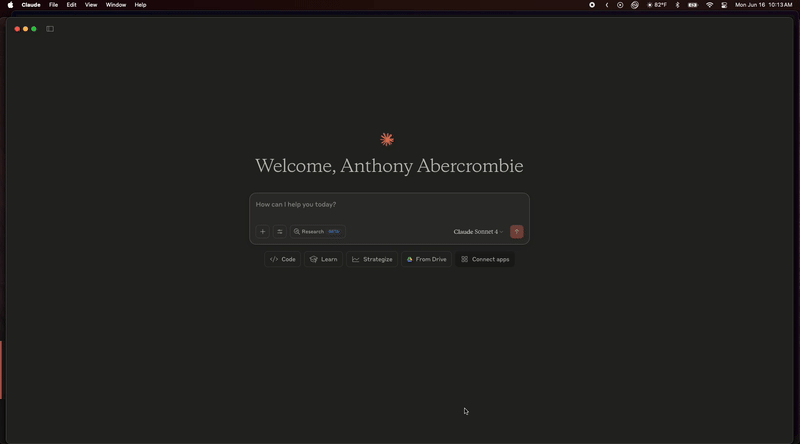

# Text-to-GraphQL MCP Server

Transform natural language queries into GraphQL queries using an MCP (Model Context Protocol) server that integrates seamlessly with AI assistants like Claude Desktop and Cursor.

[](https://cursor.com/install-mcp?name=text-to-graphql&config=eyJjb21tYW5kIjoidXYgLS1kaXJlY3RvcnkgL3BhdGgvdG8vdGV4dC10by1ncmFwaHFsLW1jcCBydW4gdGV4dC10by1ncmFwaHFsLW1jcCIsImVudiI6eyJQQVRIIjoiL3BhdGgvdG8vdXYvYmluOi91c3IvYmluOi9iaW4iLCJPUEVOQUlfQVBJX0tFWSI6InlvdXJfb3BlbmFpX2FwaV9rZXlfaGVyZSIsIkdSQVBIUUxfRU5EUE9JTlQiOiJodHRwczovL3lvdXItZ3JhcGhxbC1hcGkuY29tL2dyYXBocWwiLCJHUkFQSFFMX0FQSV9LRVkiOiJ5b3VyX2FwaV9rZXlfaGVyZSIsIkdSQVBIUUxfQVVUSF9UWVBFIjoiYmVhcmVyIn19)



## 🚀 Overview

The Text-to-GraphQL MCP Server converts natural language descriptions into valid GraphQL queries using an AI agent built with LangGraph. It provides a bridge between human language and GraphQL APIs, making database and API interactions more intuitive for developers and non-technical users alike.

## ✨ Features

- **Natural Language to GraphQL**: Convert plain English queries to valid GraphQL
- **Schema Management**: Introspects your GraphQL schema automatically and refreshes it on a TTL
- **Query Validation**: Validate generated queries against loaded schemas
- **Query Execution**: Execute queries against GraphQL endpoints with authentication
- **Query History**: Track and manage query history across sessions
- **MCP Protocol**: Full compatibility with Claude Desktop, Cursor, and other MCP clients
- **Error Handling**: Graceful error handling with detailed debugging information
- **Schema Caching**: Schemas are cached in memory and on disk with a configurable TTL, so a long-running server picks up schema changes on its own and a restart does not force a re-introspection

## 🛠 Installation

### Prerequisites: Install UV (Recommended)

UV is a fast Python package installer and resolver. Install it first:

**macOS/Linux:**
```bash
curl -LsSf https://astral.sh/uv/install.sh | sh
```

**Windows:**
```bash
powershell -c "irm https://astral.sh/uv/install.ps1 | iex"
```

**Find your UV installation path:**
```bash
# Find where uv is installed
which uv

# Common locations:
# macOS/Linux: ~/.local/bin/uv
# Windows: %APPDATA%\uv\bin\uv.exe
```

> **Important**: You'll need the UV path for MCP configuration. The typical path is `~/.local/bin` on macOS/Linux, which translates to `/Users/yourusername/.local/bin` (replace `yourusername` with your actual username).

### Setup for MCP Usage

```bash
# Clone the repository
git clone https://github.com/Arize-ai/text-to-graphql-mcp.git
cd text-to-graphql-mcp

# Install dependencies (UV automatically creates virtual environment)
uv sync

# Test the installation
uv run text-to-graphql-mcp --help
```

> **Note**: The `uv run` pattern automatically handles virtual environments, making MCP configuration cleaner and more reliable than traditional pip installations.

### Alternative Installation Methods

**From PyPI (when published):**
```bash
pip install text-to-graphql-mcp
```

**Development Setup:**
```bash
# For contributing to the project
uv sync --dev
```

## 🏃‍♂️ Quick Start

### 1. Configure with Cursor (Recommended)

Add to your `.cursor/mcp.json`:

```json
{
  "text-to-graphql": {
    "command": "uv",
    "args": [
      "--directory",
      "/path/to/text-to-graphql-mcp",
      "run",
      "text-to-graphql-mcp"
    ],
    "env": {
      "PATH": "/path/to/uv/bin:/usr/bin:/bin",
      "OPENAI_API_KEY": "your_openai_api_key_here",
      "GRAPHQL_ENDPOINT": "https://your-graphql-api.com/graphql",
      "GRAPHQL_API_KEY": "your_api_key_here",
      "GRAPHQL_AUTH_TYPE": "bearer"
    }
  }
}
```

> **Important Setup Notes:**
> - Replace `/path/to/text-to-graphql-mcp` with the actual path to your cloned repository
> - Replace `/path/to/uv/bin` with your actual UV installation path (typically `/Users/yourusername/.local/bin` on macOS)
> - The `PATH` environment variable is **required** for MCP clients to find the `uv` command

### 2. Configure with Claude Desktop

Add to your Claude Desktop MCP configuration file:

**macOS:** `~/Library/Application Support/Claude/claude_desktop_config.json`
**Windows:** `%APPDATA%\Claude\claude_desktop_config.json`

```json
{
  "mcpServers": {
    "text-to-graphql": {
      "command": "uv",
      "args": [
        "--directory",
        "/path/to/text-to-graphql-mcp",
        "run",
        "text-to-graphql-mcp"
      ],
      "env": {
        "PATH": "/path/to/uv/bin:/usr/bin:/bin",
        "OPENAI_API_KEY": "your_openai_api_key_here",
        "GRAPHQL_ENDPOINT": "https://your-graphql-api.com/graphql",
        "GRAPHQL_API_KEY": "your_api_key_here",
        "GRAPHQL_AUTH_TYPE": "bearer"
      }
    }
  }
}
```

> **Setup Instructions:**
> 1. **Find your UV path**: Run `which uv` in terminal (typically `/Users/yourusername/.local/bin/uv`)
> 2. **Set the PATH**: Use the directory containing `uv` (e.g., `/Users/yourusername/.local/bin`)
> 3. **Replace paths**: Update both the `--directory` argument and `PATH` environment variable with your actual paths
> 4. **Add your API keys**: Replace the placeholder values with your actual API keys

### 3. Common UV Path Examples

```bash
# Find your UV installation
which uv

# Common paths by OS:
# macOS: /Users/yourusername/.local/bin/uv
# Linux: /home/yourusername/.local/bin/uv  
# Windows: C:\Users\yourusername\AppData\Roaming\uv\bin\uv.exe

# For MCP config, use the directory path:
# macOS: /Users/yourusername/.local/bin
# Linux: /home/yourusername/.local/bin
# Windows: C:\Users\yourusername\AppData\Roaming\uv\bin
```

### 4. Alternative: Use Environment Variables

If you prefer using a `.env` file (useful for local development):

```env
# Required
OPENAI_API_KEY=your_openai_api_key_here
GRAPHQL_ENDPOINT=https://your-graphql-api.com/graphql
GRAPHQL_API_KEY=your_api_key_here

# Optional - Authentication method (bearer|apikey|direct)
GRAPHQL_AUTH_TYPE=bearer

# Optional - Model settings
MODEL_NAME=gpt-4o
MODEL_TEMPERATURE=0
```

Then use a simplified MCP configuration (still requires PATH):

```json
{
  "text-to-graphql": {
    "command": "uv",
    "args": [
      "--directory",
      "/path/to/text-to-graphql-mcp",
      "run",
      "text-to-graphql-mcp"
    ],
    "env": {
      "PATH": "/path/to/uv/bin:/usr/bin:/bin"
    }
  }
}
```

### 5. Run the MCP Server (Optional - for testing)

```bash
# Run the server directly for testing
text-to-graphql-mcp

# Or run as a module
python -m text_to_graphql_mcp.mcp_server
```

## 🔧 Usage

### Available MCP Tools

#### `generate_graphql_query`
Convert natural language to GraphQL queries.

```
Input: "Get all users with their names and emails"
Output: query { users { id name email } }
```

#### `validate_graphql_query`
Validate GraphQL queries against the loaded schema.

#### `execute_graphql_query`
Execute GraphQL queries and return formatted results.

#### `get_query_history`
Retrieve the history of all queries in the current session.

#### `refresh_schema`
Force an immediate re-introspection of the GraphQL schema.

This is an escape hatch. The schema is cached and refreshed automatically once
`SCHEMA_CACHE_TTL_SECONDS` elapses, so you do not need to call this before
normal queries. Reach for it when you know the schema just changed and cannot
wait for the TTL, or when diagnosing a suspected stale-schema problem. It
reports whether the schema actually changed, and if the refresh fails the
previously cached schema is retained and stays in use.

#### `get_query_examples`
Get example queries to understand the system's capabilities.

### Example Interactions

**Natural Language Input:**
```
"Show me all blog posts from the last week with their authors and comment counts"
```

**Generated GraphQL:**
```graphql
query {
  posts(where: { createdAt: { gte: "2024-06-05T00:00:00Z" } }) {
    id
    title
    content
    createdAt
    author {
      id
      name
      email
    }
    comments {
      id
    }
    _count {
      comments
    }
  }
}
```

## 🐳 Deploying with Docker

> **💡 Key Concept**: When using Docker with MCP clients (Claude/Cursor), environment variables are set during container startup (`docker run`), not in the MCP client configuration. The MCP clients simply connect to the already-running container.

### Building the Docker Image

```bash
# Clone the repository
git clone https://github.com/Arize-ai/text-to-graphql-mcp.git
cd text-to-graphql-mcp

# Build the Docker image
docker build -t text-to-graphql-mcp .
```

### Running the Container

#### Method 1: Using Environment Variables Directly

```bash
docker run -d \
  --name text-to-graphql-mcp \
  -p 8000:8000 \
  -e OPENAI_API_KEY="your_openai_api_key_here" \
  -e GRAPHQL_ENDPOINT="https://your-graphql-api.com/graphql" \
  -e GRAPHQL_API_KEY="your_api_key_here" \
  -e GRAPHQL_AUTH_TYPE="bearer" \
  -e MODEL_NAME="gpt-4o" \
  text-to-graphql-mcp
```

#### Method 2: Using an Environment File

Create a `.env` file:
```env
OPENAI_API_KEY=your_openai_api_key_here
GRAPHQL_ENDPOINT=https://your-graphql-api.com/graphql
GRAPHQL_API_KEY=your_api_key_here
GRAPHQL_AUTH_TYPE=bearer
MODEL_NAME=gpt-4o
MODEL_TEMPERATURE=0
```

Run the container:
```bash
docker run -d \
  --name text-to-graphql-mcp \
  -p 8000:8000 \
  --env-file .env \
  text-to-graphql-mcp
```

#### Method 3: Using Docker Compose

Create a `docker-compose.yml` file:
```yaml
version: '3.8'

services:
  text-to-graphql-mcp:
    build: .
    container_name: text-to-graphql-mcp
    ports:
      - "8000:8000"
    environment:
      - OPENAI_API_KEY=${OPENAI_API_KEY}
      - GRAPHQL_ENDPOINT=${GRAPHQL_ENDPOINT}
      - GRAPHQL_API_KEY=${GRAPHQL_API_KEY}
      - GRAPHQL_AUTH_TYPE=${GRAPHQL_AUTH_TYPE:-bearer}
      - MODEL_NAME=${MODEL_NAME:-gpt-4o}
      - MODEL_TEMPERATURE=${MODEL_TEMPERATURE:-0}
      - API_HOST=0.0.0.0  # Important: bind to all interfaces in container
    restart: unless-stopped
    healthcheck:
      test: ["CMD", "curl", "-f", "http://localhost:8000/health"]
      interval: 30s
      timeout: 10s
      retries: 3
```

Then run:
```bash
# Start the service
docker-compose up -d

# View logs
docker-compose logs -f

# Stop the service
docker-compose down
```

### Using Docker with MCP Clients

When running the MCP server in Docker, you need to use `docker exec` to communicate with the container:

**Important**: The environment variables (OPENAI_API_KEY, GRAPHQL_ENDPOINT, etc.) must be set when you **first run the container** using one of the methods above. The MCP client configurations below only connect to an already-running container.

#### Step 1: First, ensure your container is running with environment variables

```bash
# Example: Make sure the container is running with your environment variables
docker run -d \
  --name text-to-graphql-mcp \
  -p 8000:8000 \
  --env-file .env \
  text-to-graphql-mcp

# Verify the container is running
docker ps | grep text-to-graphql-mcp
```

#### Step 2: Configure Cursor

Add to `.cursor/mcp.json`:
```json
{
  "text-to-graphql": {
    "command": "docker",
    "args": [
      "exec",
      "-i",
      "text-to-graphql-mcp",
      "uv",
      "run",
      "python",
      "-m",
      "src.text_to_graphql_mcp.mcp_server"
    ]
  }
}
```

#### Step 2: Configure Claude Desktop

Add to your Claude Desktop configuration:
```json
{
  "mcpServers": {
    "text-to-graphql": {
      "command": "docker",
      "args": [
        "exec",
        "-i",
        "text-to-graphql-mcp",
        "uv",
        "run",
        "python",
        "-m",
        "src.text_to_graphql_mcp.mcp_server"
      ]
    }
  }
}
```

**Note**: The MCP client configurations don't need environment variables because they're connecting to a container that already has them set. If you restart the container, make sure to include the environment variables again.


## 🏗 Architecture

The system uses a multi-agent architecture built with LangGraph:

1. **Intent Recognition**: Understands what the user wants to accomplish
2. **Schema Management**: Resolves the GraphQL schema from cache or live introspection
3. **Query Construction**: Builds GraphQL queries from natural language
4. **Query Validation**: Ensures queries are valid against the schema
5. **Query Execution**: Executes queries against the GraphQL endpoint
6. **Data Visualization**: Provides recommendations for visualizing results

## ⚙️ Configuration

### Environment Variables

| Variable | Description | Default |
|----------|-------------|---------|
| `OPENAI_API_KEY` | OpenAI API key for LLM operations | Required |
| `GRAPHQL_ENDPOINT` | GraphQL API endpoint URL | Required |
| `GRAPHQL_API_KEY` | API key for your GraphQL service | Required |
| `GRAPHQL_AUTH_TYPE` | Authentication method: `bearer`, `apikey`, or `direct` | `bearer` |
| `GRAPHQL_HEADERS` | Custom headers as JSON (overrides auto-auth) | `{}` |
| `MODEL_NAME` | OpenAI model to use | `gpt-4o` |
| `MODEL_TEMPERATURE` | Model temperature for responses | `0` |
| `API_HOST` | Server host address | `127.0.0.1` |
| `API_PORT` | Server port | `8000` |
| `RECURSION_LIMIT` | Max recursion for agent workflow | `10` |
| `SCHEMA_CACHE_TTL_SECONDS` | How long a cached schema is served before re-introspecting | `3600` |
| `SCHEMA_CACHE_DIR` | Override the schema cache directory | `$XDG_CACHE_HOME/text-to-graphql-mcp/schemas`, else `~/.cache/text-to-graphql-mcp/schemas` |

#### Authentication Types

- **`bearer`** (default): Uses `Authorization: Bearer <token>` - standard for most GraphQL APIs
- **`apikey`**: Uses `X-API-Key: <key>` - used by some APIs like Arize
- **`direct`**: Uses `Authorization: <token>` - direct token without Bearer prefix
- **Custom**: Set `GRAPHQL_HEADERS` to override with any custom authentication format

#### Common GraphQL API Examples

**GitHub GraphQL API:**
```env
GRAPHQL_ENDPOINT=https://api.github.com/graphql
GRAPHQL_API_KEY=ghp_your_github_personal_access_token
GRAPHQL_AUTH_TYPE=bearer
```

**Shopify GraphQL API:**
```env
GRAPHQL_ENDPOINT=https://your-shop.myshopify.com/admin/api/2023-10/graphql.json
GRAPHQL_API_KEY=your_shopify_access_token
GRAPHQL_AUTH_TYPE=bearer
```

**Arize GraphQL API:**
```env
GRAPHQL_ENDPOINT=https://app.arize.com/graphql
GRAPHQL_API_KEY=your_arize_developer_api_key
# Auth type auto-detected for Arize
```

**Hasura:**
```env
GRAPHQL_ENDPOINT=https://your-app.hasura.app/v1/graphql
GRAPHQL_HEADERS={"x-hasura-admin-secret": "your_admin_secret"}
```


## 🔍 Observability & Agent Development

Want to build better AI agents quickly? Check out **[Arize Phoenix](https://phoenix.arize.com/)** - an open-source observability platform specifically designed for LLM applications and agents. Phoenix provides:

- **Real-time monitoring** of your agent's performance and behavior
- **Trace visualization** to understand complex agent workflows
- **Evaluation frameworks** for testing and improving agent responses
- **Data quality insights** to identify issues with your training data
- **Cost tracking** for LLM API usage optimization

Phoenix integrates seamlessly with LangChain and LangGraph (which this project uses) and can help you:
- Debug agent behavior when queries aren't generated correctly
- Monitor GraphQL query quality and success rates
- Track user satisfaction and query complexity
- Optimize your agent's prompt engineering

**Get started with Phoenix:**
```bash
pip install arize-phoenix
phoenix serve
```

Visit [docs.arize.com/phoenix](https://docs.arize.com/phoenix) for comprehensive guides on agent observability and development best practices.

## 🧪 Development

### Setup Development Environment

```bash
# Install development dependencies
uv pip install -e ".[dev]"

# Run tests
pytest

# Format code
black .
isort .

# Type checking
mypy src/
```

### Project Structure

```
text-to-graphql-mcp/
├── src/text_to_graphql_mcp/     # Main package
│   ├── mcp_server.py            # MCP server implementation
│   ├── agent.py                 # LangGraph agent logic
│   ├── config.py                # Configuration management
│   ├── schema_cache.py          # Schema TTL cache, disk cache and refresh
│   ├── logger.py                # Logging utilities
│   ├── tools/                   # Agent tools
│   └── ...
├── tests/                       # Test suite
├── docs/                        # Documentation
├── pyproject.toml              # Package configuration
└── README.md
```

## 🤝 Contributing

We welcome contributions! Please see our contributing guidelines for details.

1. Fork the repository
2. Create a feature branch (`git checkout -b feature/amazing-feature`)
3. Commit your changes (`git commit -m 'Add some amazing feature'`)
4. Push to the branch (`git push origin feature/amazing-feature`)
5. Open a Pull Request

## 📝 License

This project is licensed under the Elastic License 2.0 (ELv2) - see the [LICENSE](LICENSE) file for details.

## 🐛 Troubleshooting

### Common Issues

**"No module named 'text_to_graphql_mcp'"**
- Ensure you've installed the package: `pip install text-to-graphql-mcp`

**"OpenAI API key not found"**
- Set your `OPENAI_API_KEY` environment variable
- Check your `.env` file configuration

**"GraphQL endpoint not reachable"**
- Verify your `GRAPHQL_ENDPOINT` URL
- Check network connectivity and authentication

**"Schema introspection failed"**
- Ensure the GraphQL endpoint supports introspection
- Check authentication headers if required
- If a previously cached schema exists it is still used, so queries keep working
  on the last known-good schema. The log line says which source was used
  (`memory`, `fresh_cache`, `live` or `stale_cache`).

**"The server is using an out-of-date schema"**
- Schemas refresh automatically once `SCHEMA_CACHE_TTL_SECONDS` (default 3600)
  elapses. Lower it if you need changes picked up sooner.
- To refresh immediately, call the `refresh_schema` tool. It reports the
  previous and current schema hashes so you can confirm the change landed.
- To inspect or clear the cache by hand, look in `SCHEMA_CACHE_DIR` (by default
  `~/.cache/text-to-graphql-mcp/schemas`). Cache files are named by endpoint
  host plus a hash of the full endpoint URL, and contain no credentials.

## 🔗 Links

- [Issues & Bug Reports](https://github.com/Arize-ai/text-to-graphql-mcp/issues)
- [MCP Protocol Documentation](https://spec.modelcontextprotocol.io/)

## 🙏 Acknowledgments

- Built with [LangChain](https://langchain.com/) and [LangGraph](https://langchain-ai.github.io/langgraph/)
- Uses [FastMCP](https://github.com/jlowin/fastmcp) for MCP server implementation

---